# QMK Userspace — crunchyflakes

Personal [QMK userspace](https://github.com/qmk/qmk_userspace) for a splitkb
Kyria rev3 keyboard and a Ploopy Classic 2 trackball, used daily on Linux.

## Keymaps

| Keyboard | Keymap | Purpose |
|----------|--------|---------|
| `splitkb/kyria/rev3` | [`first`](keyboards/splitkb/kyria/rev3/keymaps/first) | Daily driver — typing, programming, German text, gaming |
| `splitkb/kyria/rev3` | [`work`](keyboards/splitkb/kyria/rev3/keymaps/work) | Same as `first` (shared via `#include`), OLEDs disabled |
| `ploopyco/trackball/rev1_007` | [`default`](keyboards/ploopyco/trackball/keymaps/default) | Ploopy Classic 2 trackball, follows the Kyria's mode |

### Kyria (`first` / `work`)

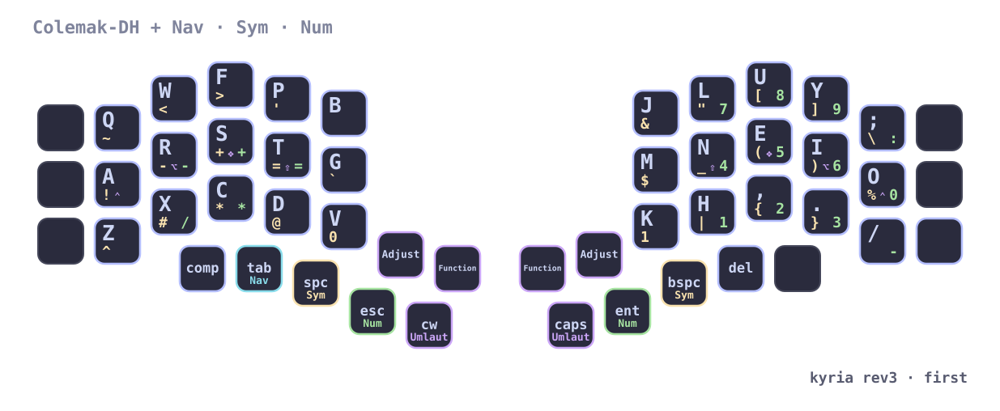

Each key shows its base letter (large, top-left) plus what it sends on
**Nav** (blue, top-right), **Sym** (yellow, bottom-left) and **Num**
(green, bottom-right); the small symbol at the bottom is the home row mod
(⇧ Shift, ⌃ Ctrl, ⌥ Alt, ❖ Super). Thumb keys are outlined in the color of
the layer they hold.

<details>
<summary>Other layers</summary>

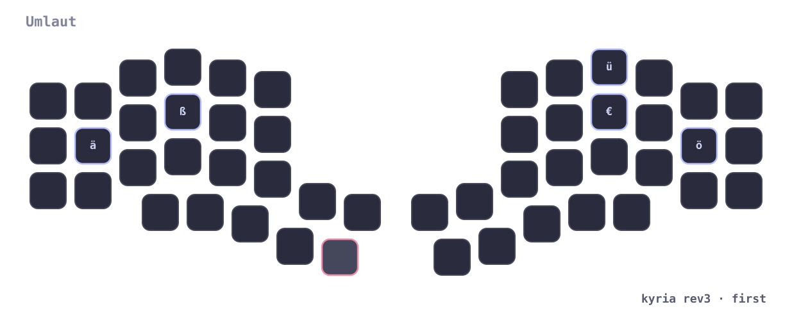
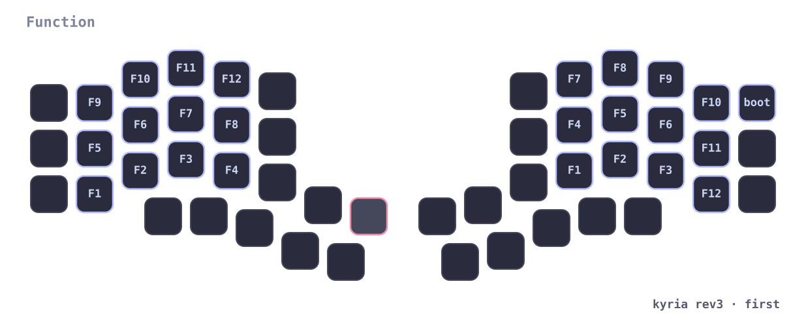
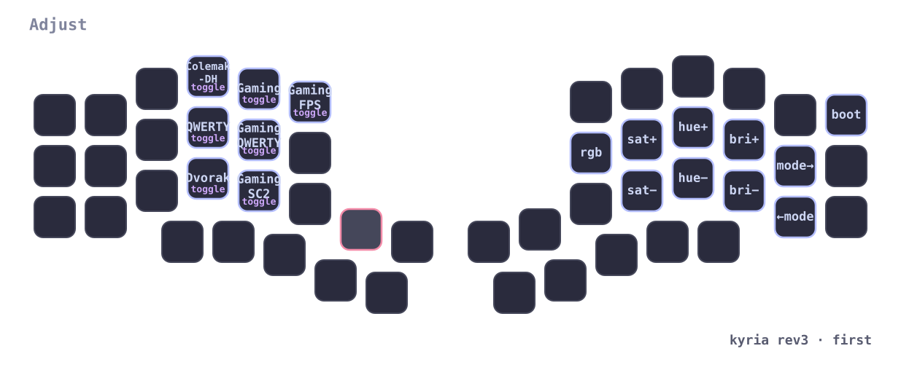
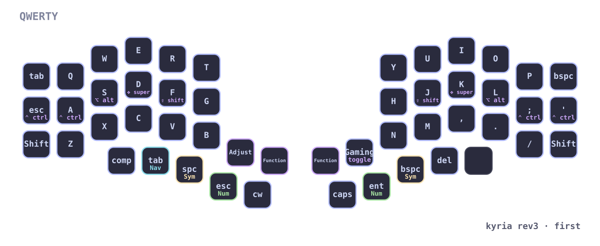
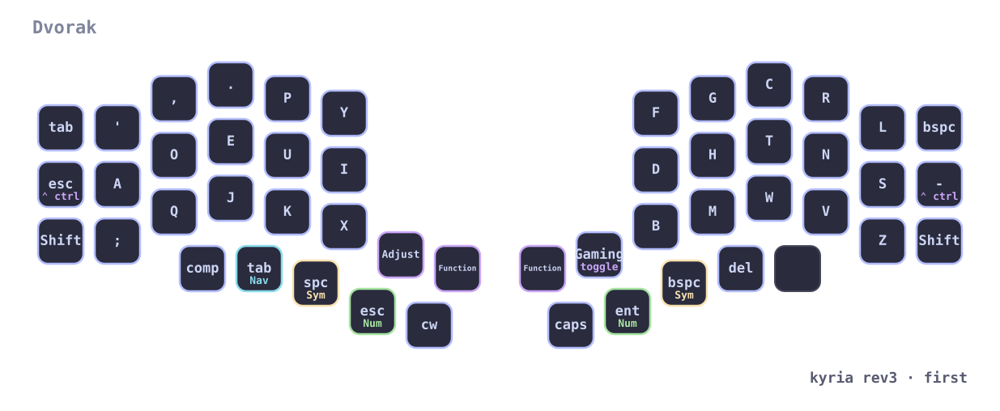
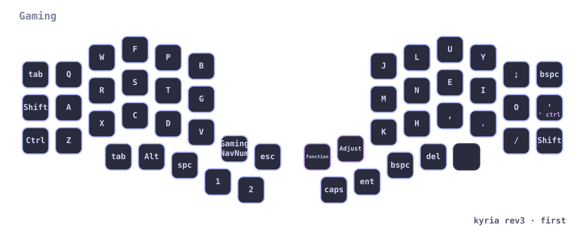
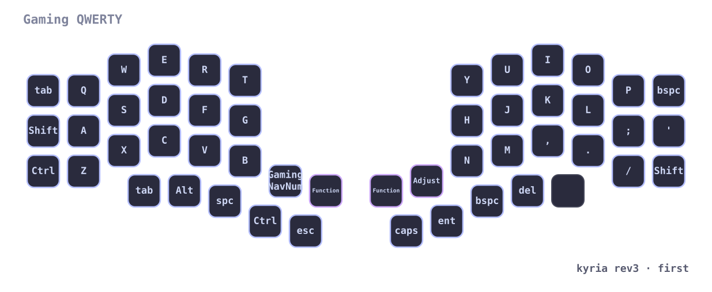
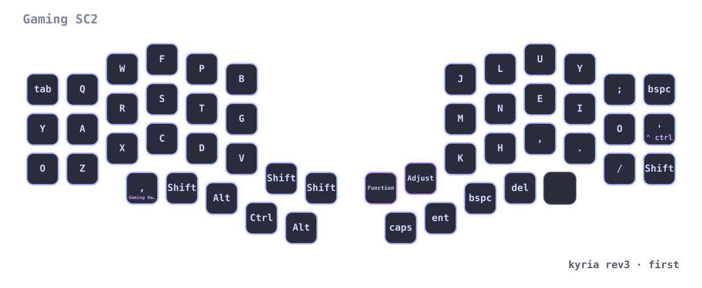
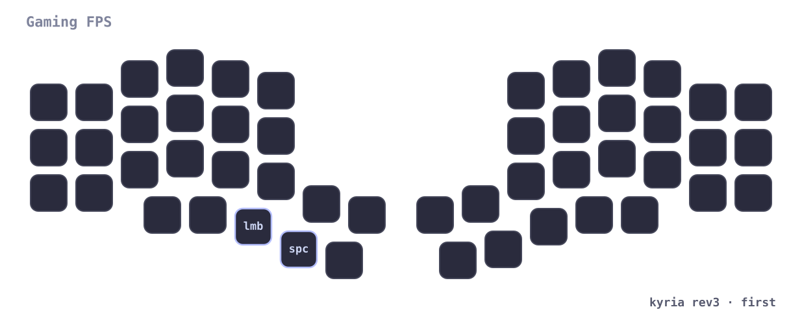
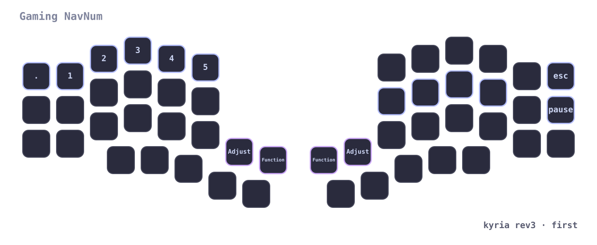

</details>

More details: [keymap readme](keyboards/splitkb/kyria/rev3/keymaps/first/readme.md).

- **Colemak-DH** base layer, with QWERTY and Dvorak alternatives.
- **Home row mods** tuned with Chordal Hold, Permissive Hold and Speculative
  Hold (longer tapping term on pinky/ring; one-handed Ctrl+C / Ctrl+V allowed).
- **Thumb-driven layers**: Nav, Sym, Num and Umlaut on the thumbs; Sym + Nav
  together = Adjust (tri-layer). Layers held by two keys stay on until both
  are released.
- **German umlauts and €** via XKB compose sequences (Menu = Compose), so the
  host layout stays US; works with Shift and Caps Word.
- **Caps Word** on a thumb tap, with a 5 s idle timeout.
- **Shift+Backspace → Delete** on tap only (holding the key still gives Sym).
- **Select Word** on the Nav layer (`getreuer/select_word` module).
- **Gaming**: five layers without tap-hold keys (Colemak, QWERTY, StarCraft II,
  FPS overlay, nav/num), forced NKRO, and a Tab+Y → J combo active only there.
- **Extras**: encoders (volume, Page Up/Down), OLED layer display, and layer
  sync to the trackball over Raw HID.

### Ploopy trackball (`default`)

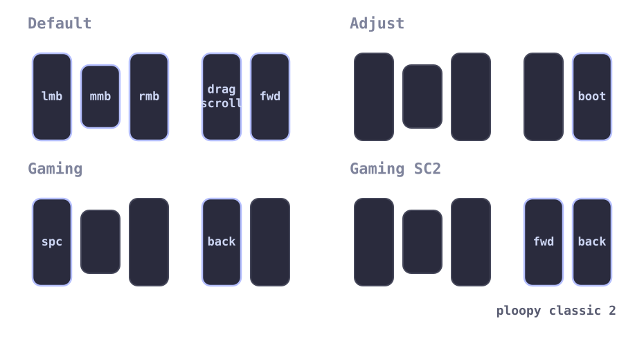

- Buttons: left click, middle click, right click, momentary (inverted) drag
  scroll, and mouse button 5.
- DPI options 400 / 600 / 1200 / 1600 (default 1600).
- **Follows the Kyria's mode**: the Kyria sends its mode (default / adjust /
  gaming / gaming-SC2) over Raw HID, and a host-side relay forwards it to the
  trackball, which switches layers:
  - Gaming: left button = Space, drag-scroll button = mouse button 4.
  - Gaming-SC2: extra mouse buttons 4 and 5.
  - Adjust: a button becomes `QK_BOOT` for flashing.

## Modules

[getreuer/qmk-modules](https://github.com/getreuer/qmk-modules) is included as
a git submodule in `modules/getreuer` (currently used: `select_word`). Clone
with:

```sh
git clone --recurse-submodules <repo-url>
# or, in an existing clone:
git submodule update --init --recursive
```

## Building

**GitHub Actions**: every push builds all targets listed in `qmk.json` and
attaches the firmware to the repository's Releases.

**Locally** (needs `qmk setup` done first):

```sh
qmk config user.overlay_dir="$(realpath .)"   # run from this repo
qmk userspace-compile                         # all targets
qmk compile -kb splitkb/kyria/rev3 -km first  # or a single one
```

Or with [`just`](https://github.com/casey/just), which also writes a
`compile_commands.json` for clangd:

```sh
just compile-all       # every keymap in qmk.json
just compile first     # one keymap: first, work or trackball
```

Code style and YAML/JSON checks run via [pre-commit](https://pre-commit.com):

```sh
uv sync
uv run pre-commit install   # clang-format (needs clang-format), yaml/json checks
```

## Layer figures

The figures in `docs/keymaps/` are generated from `keymap.c` with
[keymap-drawer](https://github.com/caksoylar/keymap-drawer)
(`keymap-drawer/draw.py`, style and labels in `keymap-drawer/config.yaml`).
The *Draw keymaps* workflow redraws and commits them whenever a `keymap.c`
changes, so `git pull` after pushing a keymap change. To draw locally (needs
`qmk` and `keymap-drawer` installed and `QMK_HOME` set):

```sh
python3 keymap-drawer/draw.py
```

## Flashing

Both boards are RP2040: double-tap reset (on the Kyria, once per half), then
copy the `.uf2` onto the mounted drive. On a running board, `QK_BOOT` (Kyria:
Function or Adjust layer; trackball: Adjust mode) enters the bootloader too.

## Acknowledgements

This userspace is heavily influenced by
[ratoru/qmk_userspace](https://github.com/ratoru/qmk_userspace): the whole
setup of the Kyria keymap — home row mods, thumb layers, corner-legend layer
figures — follows it, and the keymap-drawer tooling is ported from it.
